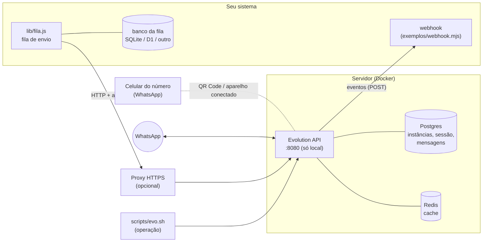
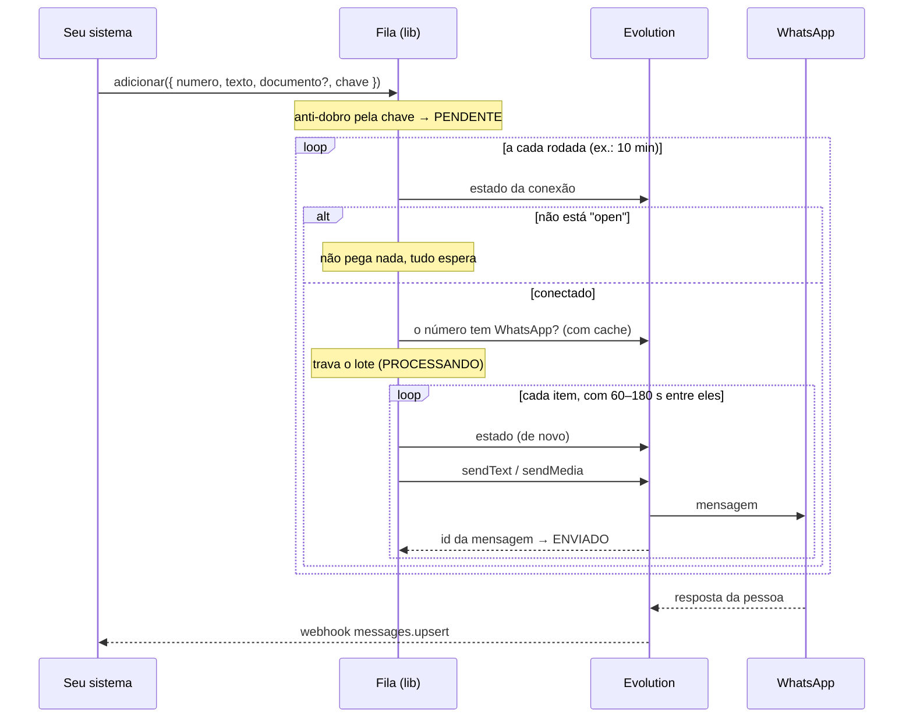
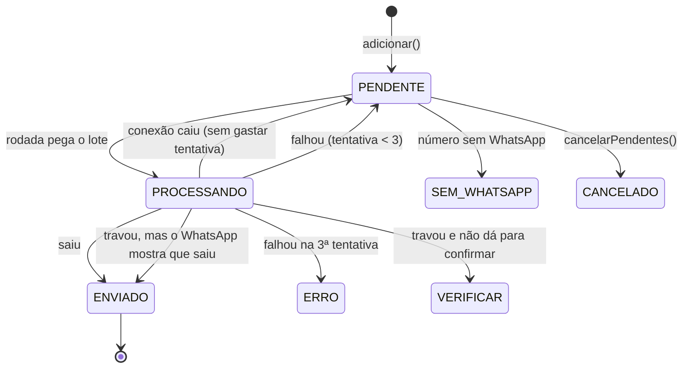

# 1. Visão geral

O kit liga um sistema qualquer a um número de WhatsApp para **enviar mensagens e documentos** e **receber respostas**, usando a [Evolution API](https://github.com/EvolutionAPI/evolution-api). A Evolution é um servidor que se conecta ao WhatsApp como um "aparelho conectado", do mesmo jeito que o WhatsApp Web.

Ele foi separado do Controle CRC-Jud, onde a robô "Rôsinha" entrega certidões pelo WhatsApp desde setembro de 2026. As regras de envio deste kit são as que sobreviveram a mais de mil envios reais, a quedas de conexão e a bloqueios do número.

## Peças

| Peça | Onde roda | Para quê |
| --- | --- | --- |
| `docker/docker-compose.yml` | servidor | Sobe Evolution, Postgres e Redis |
| `scripts/evo.sh` | servidor | Criar instância, QR Code, estado, logout, destravar, webhook, teste |
| `lib/evolution.js` | seu sistema | Cliente da API: estado, validar número, enviar, buscar enviadas |
| `lib/validador.js` | seu sistema | Valida o número com cache |
| `lib/fila.js` | seu sistema | Fila de envio com as proteções |
| `lib/armazenamento.js` | seu sistema | Onde a fila guarda os itens (memória, SQLite, D1) |
| `lib/webhook.js` | seu sistema | Lê os eventos que a Evolution manda (respostas, conexão) |
| `exemplos/` | seu sistema | Robô pronto, enfileirar pelo terminal, receptor de webhook |

**Instância** é o nome que a Evolution dá a um número conectado, por exemplo `MeuProjeto`. Um servidor pode ter várias instâncias, cada uma com um número. O sistema fala sempre com o **nome da instância**: trocar o número da instância não muda nada no sistema.

## O caminho de uma mensagem

## Situações de um item da fila

## O que o kit não faz

- **Atendimento humano** (caixa de entrada para a equipe responder). Para isso, ligue a Evolution a um Chatwoot. No Controle CRC-Jud é assim, mas essa parte ficou fora do kit.
- **Disparo em massa para quem não conhece o número.** As regras do kit reduzem o risco de bloqueio, mas não o eliminam. Veja [Operação → Como não ser bloqueado](05-operacao.md#como-não-ser-bloqueado).
- **API oficial do WhatsApp (Cloud API/Meta).** A Evolution aqui usa o modo "aparelho conectado" (Baileys), que não tem custo por mensagem, mas está sujeito às regras e aos bloqueios do WhatsApp.
